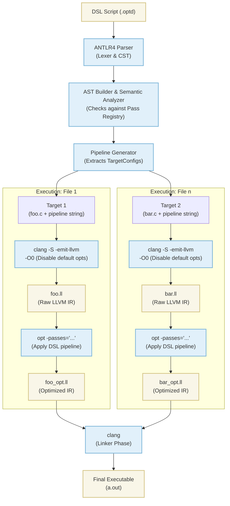

# OptDsl

## Overview

OptDsl is a Domain-Specific Language that lets you choose and parametrize the optimizations of your code. It works with the new pass manager of llvm and specifically with the `opt` tool. The pipeline goes as follows:



- `samples/`: contains all the files generated for the main process above (raw ir, opt ir, executable).
- `debug/`: contains the `.dot` files so the AST and CST can be visualized for debugging purposes.
- `scripts/`: contains bash scripts that automatically do things such as the making of the graphs and deep cleaning the project.

## Requirements

You must have dotnet, llvm, clang and opt tools installed. If you want to visualize the graphs you must have graphviz tool installed as well.

## Usage

In every situation there is a `Properties/` directory that has a json so you can change the source file of type .optd. Dotnet automatically detects it and runs the project with the specifications of the file.

For CLI use it as this at the root level:

``` bash
dotnet run --project src/OptDsl
```

For any IDE just press F5. For VSCode users there is a `.vscode/` directory, but it does the same thing as mentioned.
